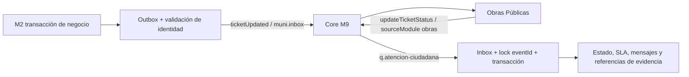

# M2 ↔ Core (M9) ↔ M3 Obras Públicas

## Alcance y fuentes

Se reutilizan Inbox/Outbox y transiciones de M2. No se llaman APIs de M3 ni se cambian
identidad, JWT, M1, schemas o estados. Los DOCX «Eventos M2 V1.79» y «M3 v0.7» no estaban
presentes durante esta implementación. Los ejemplos de `examples/` son fixtures sintéticas
validadas contra los schemas locales v1.78, no copias de ejemplos oficiales. La homologación
bilateral de v1.79/v0.7 y de la política DLQ queda pendiente de esos documentos y del Core.

## Estado inicial y cambios

Ya existían snapshot ROUTED y reassignment, exclusión de evidencias privadas/propuestas,
validación de identidad de salida, confirmaciones Rabbit, locks por eventId/ticket,
transiciones canónicas, información pendiente única, SLA y cancelación con duplicados.
Se conservaron esas implementaciones y se añadieron regresiones específicas de M3.

Las brechas corregidas eran el rechazo EXTERNAL_ATTACHMENTS_UNSUPPORTED, el borrado de
attachments al deserializar, la validación de PROGRESS que omitía evidencias como contenido,
y la ausencia de tratamiento definitivo/auditado de errores de negocio en el consumer.
También se rechazan hechos anteriores a la fecha del estado actual (no sólo al último
hecho externo), para proteger reaperturas y derivaciones locales recientes.

## Eventos y autoridad

- Salida: `ticketUpdated` con `sourceModule=atencion-ciudadana`, versión `1.0`, UUID
  `data.ticketId` y `publicId` humano estable. M3 debe consumir sólo sus tickets (`M3`).
- `ROUTED` lleva clasificación, descripción, respuestas del formulario, ubicación sin
  coordenadas, vencimiento, escalamiento y evidencias PUBLIC autorizadas. `reassignment`
  es true sólo en la derivación posterior a una reclasificación excepcional confirmada.
- `INFORMATION_PROVIDED` comunica la respuesta a una solicitud del área y reanuda SLA.
  `REOPENED` y `CANCELLED` siguen las reglas actuales. `PRIORITY_CHANGED` y
  `ESCALATION_CHANGED` conserva sus productores existentes. El recálculo automático de
  prioridad registra actividad local y NO emite PRIORITY_CHANGED por diseño de
  TicketPriorityService; no se agrega una publicación automática no prevista.
- Un evento con `purpose=RECLASSIFICATION` no habilita gestión operativa: esperar el
  posterior `ROUTED`. El código de propuestas y sus evidencias aisladas se conserva.
- `ticketCreated` se mantiene para la proyección identificada de M1; no es la orden de
  gestión de M3. La suscripción de M3 debe ser a `ticketUpdated`, no `ticketCreated`.
- Entrada: `updateTicketStatus`, productor `obras` → `M3`; schema/envelope, actor, UUID y
  fechas validados; área responsable actual obligatoria. STARTED: ROUTED→IN_PROGRESS;
  PROGRESS: IN_PROGRESS, con avance, mensaje o sólo evidencias; INFORMATION_REQUIRED:
  solicitud única y pausa de SLA; RETURNED: IN_REVIEW; RESOLVED: RESOLVED desde ROUTED o
  IN_PROGRESS con resolución y mensaje público; REJECTED: CANCELLED según reglas existentes.
  Si hay duplicados activos, REJECTED conserva la revisión de alcance, sin cancelar en bloque.
- M2 conserva prioridad, clasificación y SLA. No se publica un espejo de la transición
  externa; un cambio independiente de escalamiento de M2 puede seguir generando su evento.

## Evidencias externas

`V51__external_attachment_references.sql` agrega referencias separadas de `attachments`.
Guarda ticket, eventId, ordinal, updateType, productor y fecha del hecho, fileName,
contentType, URL y sizeBytes nullable (también admite 0). El par eventId/ordinal es único;
Inbox deduplica y los cambios se confirman o revierten juntos. No se crea un storageKey ni
un binario ficticio, no se descarga la URL, no se sigue un redirect y no hay proxy HTTP a M3.
Las URLs se admiten como HTTP(S) absolutas sin userinfo; se rechazan esquemas ejecutables,
archivos locales y referencias inválidas con un rechazo de negocio definitivo. No se verifica
su existencia ni su contenido MIME remoto. No registrar URLs: pueden contener autorizaciones.

El schema compartido no tiene visibilidad de adjuntos. Por ello las evidencias entrantes
se clasifican **INTERNAL**, incluso si RESOLVED tiene publicMessage. No se infiere permiso
público de ese mensaje ni se añade un campo al contrato. Confirmar con M3 antes de habilitar
exposición ciudadana o URLs autorizadas de larga duración. M3 conserva la autorización y
caducidad de la URL; obtener los metadatos en M2 no concede acceso al archivo de M3.

`GET /api/tickets/{ticketId}/external-attachments` devuelve sólo metadatos y `Cache-Control:
no-store`. AGENT/ADMIN pueden verlos; AREA_RESPONSIBLE sólo en su área actual. Un propietario
identificado sólo ve referencias PUBLIC (actualmente ninguna entrante); terceros y anónimos
no obtienen acceso. Los endpoints de descarga locales siguen usando FileStorage y no aceptan
estas referencias. Tampoco se incluyen en Outbox ni en las proyecciones públicas existentes.

## ACK, NACK e idempotencia

| Caso | Resultado |
| --- | --- |
| eventId ya procesado o rechazado permanentemente con el mismo hash | ACK sin repetir efectos |
| Mismo eventId con contenido diferente | NACK, EVENT_ID_COLLISION |
| Otra área, ticket inexistente, estado incompatible, hecho anterior al último hecho externo o al estado actual | Recibo Inbox de descarte y ACK; ticket inexistente además genera warning |
| Rechazo de negocio, p. ej. referencia inválida | Rollback de efectos; recibo FAILED/REJECTED_BUSINESS_RULE en transacción nueva; ACK sólo tras su commit |
| Falla al guardar ese rechazo | NACK; no se confirma una auditoría fallida |
| Schema o versión inválida | NACK |
| PROGRESS mientras aún está ROUTED | NACK PREMATURE_PROGRESS; no hay recibo definitivo; puede procesarse después de STARTED |
| Fallo transitorio de BD/commit | Rollback y NACK |
| Canal cae durante ACK | Cierra conexión propietaria; redelivery deduplicable |

Se conserva `basicNack(tag,false,false)`: **no hay requeue inmediato ni reintentos locales
infinitos**. El Core debe configurar el dead-lettering, la demora, el límite de intentos y
la DLQ final. Sin esa política el NACK puede terminar en descarte o DLQ sin reintento; no
se afirma entrega diferida sin verificar la topología real. No confundir
CORE_OUTBOX_MAX_ATTEMPTS (salida) con el límite de entregas Inbox del broker.
Los timestamps iguales no determinan orden causal por sí solos; se conservan las reglas
de estado. No hay orden total inventado ni correlación nueva de asignación en el contrato.

## Configuración

Integraciones deshabilitadas por defecto. Para pruebas locales usar PostgreSQL exclusivo,
Java 21 y Maven Wrapper. `./mvnw -B clean verify` ejecuta tests, migraciones y gate de
cobertura LINE 85%. No ejecutar las suites contra la base DEV compartida.
En Cloud, `/workspace/.cloud-setup/mvn clean verify` usa el JDK y proxy preparados;
las fixtures CI y su datasource están en `/workspace/.cloud-setup/test-env.sh` fuera del repo.

Para conectar al Core se requieren, mediante configuración segura:

- CORE_INBOX_ENABLED=true; CORE_INBOX_PREFETCH=1 (1..16); CORE_INBOX_RECONNECT_DELAY=5000.
- CORE_RABBIT_HOST; CORE_RABBIT_PORT=5671; CORE_RABBIT_VHOST=core;
  CORE_RABBIT_USERNAME y CORE_RABBIT_PASSWORD propios de M2; TLS y hostname verification.
- CORE_OUTBOX_ENABLED=true para publicar. CORE_OUTBOX_APPROVED_EVENT_IDS para aprobación
  explícita, o CORE_OUTBOX_AUTO_APPROVE_NEW_EVENTS=true exclusivamente con proveedor M1
  y simulador apagado, sin lista manual. Nunca desactivar CorePublicationPolicy ni
  OutgoingEventValidator, ni marcar identidades MOCK como M1 para publicar.
- CORE_OUTBOX_MAX_ATTEMPTS, CORE_OUTBOX_RETRY_DELAY, CORE_OUTBOX_CONNECT_TIMEOUT y
  CORE_OUTBOX_CONFIRM_TIMEOUT conservan límites y backoff actuales.
- Datasource, clave persistente de tracking e ID y configuración real de identidad del
  entorno según README. No usar material de CI en DEV persistente. No copiar secretos a JSON.

El publisher comprueba pasivamente `muni.inbox`, confirma publicación y detecta unroutable;
el consumer comprueba pasivamente `q.atencion-ciudadana`. No se declara ni modifica topología.

## Procedimiento con Core y M3

1. Con el administrador del Core, revisar registro de módulos/productores y permisos:
   M2 publica ticketUpdated, M3 publica updateTicketStatus. Confirmar que el token/usuario
   del productor queda vinculado a su sourceModule; no basta confiar en el JSON del emisor.
2. Registrar o verificar suscripción M3 a ticketUpdated y M2 a updateTicketStatus, además
   de las suscripciones M1 ya existentes sin reemplazarlas. Si el registro valida sólo
   `data`, usar `*.data.schema.json`; si valida envelope, usar `*.schema.json` de v1.78.
   Las URLs/operaciones administrativas concretas deben venir del Core; no se inventan endpoints.
3. Revisar bindings y permisos en vhost core, exchange de entrada muni.inbox, cola de M2,
   DLX/TTL o retry equivalente, límite de entregas y DLQ. Verificar el reintento de un
   PROGRESS adelantado sin bucle inmediato. Pedir autorización antes de cambiar recursos.
4. Crear un ticket de pruebas por el flujo real autorizado de M2 y derivarlo a M3. Reemplazar
   UUID, actor, publicId, fechas, catálogo y URLs de las fixtures por valores reales. No
   publicar fixtures sintéticas con credenciales de producción.
5. Verificar ROUTED en Outbox, confirm del broker y recepción en M3. Enviar STARTED y
   PROGRESS (también sólo foto); comprobar estado, actividad, Inbox y referencias.
6. Enviar INFORMATION_REQUIRED, comprobar una solicitud pendiente y SLA pausado; responder
   como propietario en M2 y verificar INFORMATION_PROVIDED recibido por M3 y SLA reanudado.
7. Probar RESOLVED con fotografía desde ROUTED y desde IN_PROGRESS en tickets distintos;
   revisar mensaje público, resolución y referencia INTERNAL accesible sólo con permisos.
   Probar RETURNED y REJECTED, incluyendo principal con duplicados activos.
8. Repetir eventId, enviar otro módulo, un evento antiguo, payload inválido y PROGRESS antes
   de STARTED. Revisar ACK/descarte/retry/DLQ según tabla, sin duplicados ni eventos espejo.
   No registrar cuerpos, tokens, claves ni URLs firmadas en la evidencia compartida.

## Bloqueos de homologación real

No se ejecutó conexión ni publicación real en Core/M3: faltan credenciales autorizadas,
confirmación de suscripciones, política de retry/DLQ y los dos contratos completos.
Falta acordar visibilidad y duración/autorización de evidencias externas. Los tests locales
no demuestran recepción bilateral real ni permiten debilitar validaciones de identidad.
