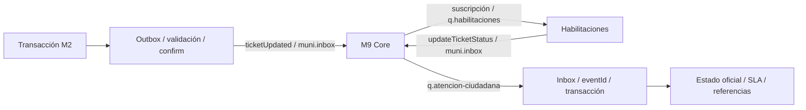

# M2 ↔ M9/Core ↔ M4 Habilitaciones

## Alcance y fuentes

Verificación local sobre `dev`, HEAD `984f5b823bb15943be3e7c765e361a0c00b54884`.
Fuentes consultadas: `Contrato_Integral_Eventos_M4 al 02-11-2026.pdf`, portada v1.2 RC
del 02/11/2026, y `Eventos M2 - V1.79.docx`, además del código, schemas locales y guías
M2–M3. El alcance de este cruce es exclusivamente M2 ↔ Core ↔ M4; las otras integraciones
del PDF no se implementan. No se ejecutan instrucciones operativas del documento como
si fueran autorización para cambiar Core.

M2 v1.79 §13.1 declara vigente el paquete de schemas v1.78, sin cambios en esta versión.
Se comprobaron los eventos, productores/áreas, tipos/UUID, transiciones, política de
publicación (§7.2/§9), reclasificación y sobre para M4 (§4.8/§5 del PDF). No se encontró
una incompatibilidad estructural en los dos ejemplos originales: las pruebas validan
ambos contra los schemas locales. Eso no acredita recepción real ni conformidad del backend M4.

### Diferencias y precisiones comprobadas

- El ROUTED original §5.1 omite causationId, progress/publicMessage y los campos opcionales
  routing.location/resolutionDueAt/escalation. El schema local los permite y M2 produce
  un snapshot más completo; se conservan. La [adaptación](examples/m4/routed-adaptado.json)
  agrega únicamente esos campos, sin alterar valores originales. No son campos faltantes
  obligatorios del ejemplo: el original también valida.
- RESOLVED §4.8 tiene attachments vacío; se prueba sin alterarlo salvo eventId/ticketId
  para aislar PostgreSQL. Las evidencias no vacías se verifican aparte en las seis variantes.
- El PDF conserva pies de página «v1.1 RC · 29/10» aunque portada e historial indican
  v1.2 RC del 02/11; discrepancia editorial, sin inferir otro contrato.
- M2 v1.79 §7.2 reserva PRIORITY_CHANGED y no obliga a publicarlo por recálculo; coincide
  con código y prueba de M4. No se agrega un productor.
- M2 v1.79 §12 detalla reintentos y endpoints de Core, pero el PDF pide verificar la
  política real. La descripción contractual no sustituye GET /api/v1/topology autenticado.
- El schema permite null/omisión en campos opcionales; el validador de publicación actual
  exige las ocho claves del envelope. No se modifica la política ni se ratifica Core por cuenta propia.

## Arquitectura reutilizada

No hay API directa, consumidor paralelo, nuevos eventos, cambios de seguridad ni migraciones.
TicketOutboxService genera snapshots y eventos incrementales; CoreOutboxProcessor,
CorePublicationPolicy, OutgoingEventValidator y RabbitCoreEventPublisher mantienen
validación, procedencia M1, aprobación y confirmaciones existentes. CoreEventConsumer,
CoreIncomingEventValidator y CoreInboxProcessor ya mapean `habilitaciones` a `M4`.
TicketStatusUpdateService aplica transiciones y SLA canónicos. DTO, servicio, entidad,
repositorio y controller de referencias externas y V51 son suficientes para M4.

## Contrato y reglas operativas

Envelope: eventId UUID, eventType, eventVersion `1.0`, occurredAt, sourceModule, data y
correlationId/causationId según schema y causalidad. Se conserva la serialización actual
de nulos/omitidos; no se resuelve unilateralmente la ratificación pendiente con Core.
El ticketId es el UUID persistente de M2; un expediente comercial no lo reemplaza.

| Dirección | Evento y reglas |
| --- | --- |
| M2 → M4 | `ticketUpdated`, sourceModule `atencion-ciudadana`; M4 debe filtrar data.responsibleAreaId=`M4` |
| M4 → M2 | `updateTicketStatus`, sourceModule `habilitaciones`; M2 comprueba área actual `M4` |

ROUTED inicia gestión; lleva UUID, publicId estable, currentStatus ROUTED, área,
prioridad/progreso, detalles de clasificación, requestType/category/subcategory/ticketType,
summary/description/formData/reassignment, ubicación sin coordenadas, resolutionDueAt,
escalation, adjuntos PUBLIC autorizados y updatedAt. Se mantienen campos adicionales
exigidos por M2 aunque no figuren en el resumen de M4. No salen mensajes internos,
metadatos privados ni evidencias de propuestas sin confirmar.

INFORMATION_PROVIDED comunica la respuesta y reanuda SLA; REOPENED mantiene el UUID;
CANCELLED informa cancelación local según reglas existentes. PRIORITY_CHANGED está definido en el schema, pero no se encontró un productor activo
en el código vigente: el recálculo periódico registra actividad local y no publica ese
evento por diseño. Esto concuerda con el valor reservado de M2 v1.79 §7.2. ESCALATION_CHANGED sigue comunicando cambios reales. En anónimos
se respetan las restricciones actuales de publicación. `purpose=RECLASSIFICATION` no
habilita gestión: esperar confirmación y ROUTED; la respuesta provisional no deriva el ticket.
`ticketCreated` continúa siendo la proyección existente de M1; no se añade un productor
para M4 y su suscripción no debe incluirlo.

| updateType entrante | Aplicación local |
| --- | --- |
| STARTED | ROUTED → IN_PROGRESS |
| PROGRESS | En IN_PROGRESS, avance/mensaje o sólo evidencias válidas |
| INFORMATION_REQUIRED | Solicitud pendiente única, pausa SLA |
| RETURNED | IN_REVIEW |
| RESOLVED | Resolución desde ROUTED o IN_PROGRESS, mensaje público y detalles requeridos |
| REJECTED | Cancelación según reglas; duplicados activos exigen revisión de alcance |

El ejemplo original RESOLVED §4.8 incluye EXTERNAL_USER con UUID, publicMessage,
resolution.type=ACTION_COMPLETED, attachments vacío y updateOccurredAt, y valida sin cambios. Schema rechaza campos no permitidos, UUID/actor/fecha inválidos.
M2 conserva estado oficial, prioridad, clasificación y SLA. No replica la transición
externa en Outbox; puede emitir un hecho independiente de escalamiento si corresponde.

## Evidencias y permisos

V51 y ExternalAttachmentService persisten referencias INTERNAL de forma atómica con
negocio/Inbox; eventId/ordinal es único. PROGRESS sólo con evidencias está permitido.
No se descargan URLs, no se crean binarios ni storageKeys ficticios y no se siguen redirects.
Se admiten URLs absolutas HTTP(S) sin userinfo; se rechazan file/javascript, referencias
relativas o inválidas. **No hay allowlist de hosts ni comprobación de existencia remota**:
la protección evita dereferenciación automática y esquemas peligrosos; la referencia no
es una garantía de confianza o acceso al archivo. No registrar URLs firmadas ni payloads.

El schema no define visibilidad: no se infiere PUBLIC de publicMessage. El endpoint
`GET /api/tickets/{ticketId}/external-attachments` usa no-store; AGENT/ADMIN y responsable
del área actual acceden, propietario sólo ve PUBLIC, terceros/anónimos no tienen acceso.
M4 mantiene autorización y caducidad remotas. No se republican estas referencias.

## ACK/NACK e idempotencia

| Caso | Política existente |
| --- | --- |
| Mismo eventId y hash procesado/rechazado | ACK sin repetir efectos |
| Colisión eventId con contenido distinto | NACK EVENT_ID_COLLISION |
| Otra área, desconocido, antiguo, estado incompatible | Recibo de descarte y ACK |
| Rechazo de negocio | Rollback; recibo FAILED/REJECTED_BUSINESS_RULE en transacción nueva; ACK tras commit |
| Fallo transitorio o de commit/auditoría | Rollback y NACK |
| PROGRESS antes de STARTED | NACK PREMATURE_PROGRESS sin recibo definitivo |
| Envelope/schema/versión inválidos | NACK |

Consumer confirma sólo después del commit. `basicNack(tag,false,false)` no reencola
inmediatamente: la entrega diferida depende de DLX/retry/DLQ del Core. No se cambió
esa topología. M2 v1.79 §12 documenta 5 s → 30 s → 2 min → 10 min, maxAttempts=4 por defecto
(cuenta entregas: ventana 2 min 35 s, sin llegar a 10 min), configurable de 1 a 10 por
suscripción. **La topología y valores efectivos no están acreditados en el broker**. Outbox tiene su propia política; no equivale al retry
entrante. Se descartan hechos anteriores al último externo o al estado local actual;
timestamps iguales siguen las reglas de estado, sin inventar orden causal total.

## Configuración

Integraciones apagadas por defecto. Reutilizar configuración segura del entorno:

| Variable | Valor/configuración |
| --- | --- |
| CORE_INBOX_ENABLED / CORE_OUTBOX_ENABLED | true sólo en entorno autorizado |
| CORE_RABBIT_HOST | host vigente confirmado por Core |
| CORE_RABBIT_PORT / CORE_RABBIT_VHOST | 5671 / core |
| CORE_RABBIT_USERNAME / CORE_RABBIT_PASSWORD | Credenciales propias de M2, fuera del repo |
| CORE_INBOX_PREFETCH / CORE_INBOX_RECONNECT_DELAY | 1 / 5000 por defecto |
| CORE_OUTBOX_APPROVED_EVENT_IDS | Lista manual autorizada |
| CORE_OUTBOX_AUTO_APPROVE_NEW_EVENTS | false por defecto; true requiere identidad M1, simulador apagado y lista manual vacía |
| CORE_OUTBOX_MAX_ATTEMPTS / CORE_OUTBOX_RETRY_DELAY | 5 / 15s por defecto; backoff existente |
| CORE_OUTBOX_CONNECT_TIMEOUT / CORE_OUTBOX_CONFIRM_TIMEOUT | 5s / 5s |
| CORE_OUTBOX_SCAN_DELAY | 1000 por defecto |

Mantener datasource, clave persistente de tracking e identidad según README del backend.
TLS usa truststore JVM y hostname verification. Publisher comprueba pasivamente
`muni.inbox`, publica mandatory y espera confirm; consumer verifica pasivamente
`q.atencion-ciudadana`. M2 no declara q.habilitaciones ni modifica recursos compartidos.

## Homologación bilateral

1. Usar los contratos y fixtures originales §5.1/§4.8 ya cotejados; ratificar nulabilidad,
   visibilidad y causalidad con Core antes de cambiar la representación de mensajes.
2. Consultar administrador del Core por estado actual de M4 y evidencia fechada de
   conexión; verificar vínculo credencial/sourceModule, permisos y registro de eventos.
3. Confirmar suscripción M4 a ticketUpdated y M2 a updateTicketStatus, colas, bindings,
   vhost y política real de retry/DLQ mediante GET /api/v1/topology y GET /api/v1/dlq. Preservar suscripciones M1/M3. M2 v1.79 §13.1 especifica que Core valida sólo data y requiere el schema
   autocontenido sin referencias externas del paquete de registro oficial. Comparar
   GET /api/v1/event-types/{nombre} parseado contra ese paquete; no cargar el schema de
   evento completo ni archivos locales con $ref externos sin resolver. No recargar schemas
   compartidos unilateralmente.
4. Con identidades reales autorizadas, crear ticket de prueba, derivar a M4 y comprobar
   Outbox/confirm/recepción M4 con el mismo eventId/UUID. El confirm no prueba consumo M4.
5. Enviar STARTED/PROGRESS, luego INFORMATION_REQUIRED; comprobar SLA pausado, respuesta
   ciudadana e INFORMATION_PROVIDED recibido por M4 sin duplicados y SLA reanudado.
6. En tickets separados probar RETURNED, RESOLVED con evidencia, REJECTED, cancelación,
   reapertura, prioridad/escalamiento y reclasificación: ninguna gestión antes de ROUTED.
7. Repetir eventId, colisionarlo, enviar área incorrecta, hechos antiguos, transición inválida
   y PROGRESS prematuro. Comprobar auditoría, atomicidad, ACK/NACK y retry/DLQ real.
8. Core deduplica antes del ruteo: reenviar el mismo eventId no recupera una entrega
   agotada. M2 v1.79 documenta POST /api/v1/dlq/{id}/retry para esa recuperación, y
   POST /api/v1/subscriptions para maxAttempts; requieren autorización de operación,
   no se ejecutan en esta verificación. El confirm AMQP tampoco prueba aceptación de
   data por Core: revisar DLQ SCHEMA_VIOLATION.
9. Guardar evidencia sanitizada de ambos módulos/Core con fecha y correlación; no secretos,
   mensajes privados ni URLs firmadas. Pedir autorización antes de cambiar topología.

Al 13/11/2026 no hay credenciales Core/M4 configuradas en esta sesión ni evidencia remota
consultable. **Estado actual de conexión y suscripciones M4: no verificado**. No se infiere
que siga desconectado por el dato del 02/11 ni que esté homologado por tests locales.
Ver resultados locales y pendientes en [verificación](verificacion-m2-m4.md).
